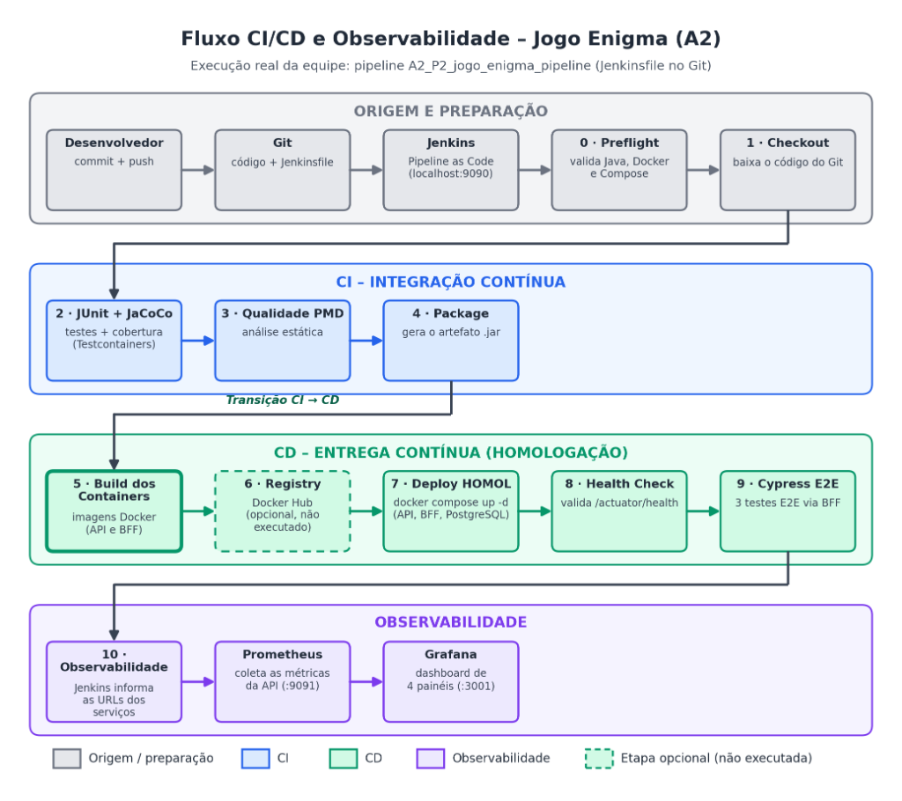

# Exercício A2 – Arquitetura CI/CD com Jenkins, Containers e Observabilidade

**Disciplina:** DevOps & QA  
**Pipeline:** V5.1 (Portável Windows/macOS/Linux)  
**Stack:** Jenkins LTS, Docker, PostgreSQL, Prometheus, Grafana, Cypress E2E

---

## O que estamos aprendendo

O Exercício A2 expande o aprendizado iniciado no A1, onde trabalhamos ferramentas pontuais de qualidade de software (JUnit, JaCoCo, PMD) executadas manualmente no ambiente local. Agora, o objetivo é entender como essas mesmas ferramentas se tornam etapas automatizadas e orquestradas dentro de uma **esteira de CI/CD completa**.

O exercício aborda quatro grandes conceitos:

**Integração Contínua (CI):** a prática de integrar e validar o código automaticamente a cada mudança. Aprendemos como o Jenkins pode executar o build, os testes unitários e a análise estática assim que uma nova versão do código é submetida, devolvendo feedback imediato para a equipe.

**Entrega Contínua (CD):** a extensão natural da CI. Após a validação do código, a aplicação é empacotada em um container Docker e implantada automaticamente em um ambiente de homologação, onde testes de ponta a ponta com Cypress validam o comportamento real do sistema.

**Pipeline as Code:** ao escrever a esteira inteiramente no `Jenkinsfile`, o pipeline passa a ser versionado no Git junto com o próprio código. Isso traz rastreabilidade, possibilidade de revisão por pares e reprodutibilidade em qualquer ambiente.

**Observabilidade:** mesmo após a entrega bem-sucedida, o trabalho não termina. Com Prometheus e Grafana, monitoramos a saúde da aplicação em tempo real, aprendendo a diferença entre qualidade *prévia* (testes) e qualidade *contínua* (métricas de produção).

---

## Fluxo da Arquitetura

O diagrama abaixo representa a esteira completa executada neste exercício, desde o commit do desenvolvedor até o monitoramento em homologação:



---

## Prática 1 – Freestyle CI com Jenkins

O ponto de partida foi criar um **job Freestyle** no Jenkins para o projeto `integracao_v1`. Nesta prática, aprendemos o modelo mais básico de automação do Jenkins: configurar um job via interface gráfica que executa o build Maven com JUnit e JaCoCo ao ser disparado.

O experimento central foi o **ciclo de build vermelho e verde**: induzimos uma falha proposital no código (invertendo uma regra de negócio de frequência), observamos o Jenkins reprovar o build automaticamente e depois corrigimos o código para restaurar o status verde. Esse ciclo demonstra na prática o que significa um *quality gate*.

**Conceito central aprendido:** o Jenkins não substitui Maven, JUnit ou JaCoCo. Ele é o orquestrador — cada ferramenta mantém sua responsabilidade específica (compilação, validação, cobertura) e o Jenkins conecta e automatiza essas etapas.

**Evidências desta prática:**
- `evidencias/p1/`: capturas do ciclo de falha e sucesso no Jenkins, console de saída, relatório JUnit e relatório de cobertura JaCoCo publicados no servidor CI.
- `evidencias/p1/complementares/`: capturas adicionais mostrando as abas de cobertura JaCoCo em detalhes (Line, Branch, Cyclomatic Complexity e Files).

---

## Prática 2 – Pipeline as Code com Jenkinsfile

A segunda prática eleva o nível: ao invés de configurar a esteira pela interface do Jenkins, escrevemos o **Jenkinsfile** — um script versionado no Git que descreve toda a esteira como código.

O pipeline implementado contém onze estágios organizados em três fases distintas (CI, CD e Observabilidade), desde a validação do ambiente local até a execução dos testes E2E com Cypress em ambiente de homologação. O estágio de publicação no Docker Hub foi implementado mas mantido desabilitado por parâmetro, demonstrando como pipelines reais controlam etapas opcionais.

**Conceito central aprendido:** a principal vantagem do Jenkinsfile não é técnica, mas arquitetural — a esteira deixa de existir apenas no servidor Jenkins e passa a ser rastreável, revisável e replicável como qualquer outro artefato de software.

**Evidências desta prática:**
- `evidencias/p2/`: configuração do job, log completo de execução bem-sucedida (Build #2) e metadados dos estágios.
- `evidencias/p2/complementares/`: Jenkinsfile aberto na IDE, grafo de execução dos estágios, histórico de builds e saída detalhada do Cypress E2E.

---

## Prática 3 – CD, Containers e Observabilidade

Com o pipeline completo validado, esta prática foca na **verificação manual do ambiente de homologação** e na configuração da **camada de observabilidade**.

Validamos que todos os serviços do stack (API, BFF, banco de dados, Prometheus e Grafana) estavam ativos e respondendo corretamente. Em seguida, construímos um dashboard no Grafana com quatro painéis: status da API, taxa de requisições HTTP, tempo médio de resposta e consumo de memória JVM Heap.

**Conceito central aprendido:** um `BUILD SUCCESS` no Jenkins não garante que a aplicação está funcionando. O Health Check do pipeline é uma sonda de prontidão, e a observabilidade com Prometheus/Grafana é o que garante visibilidade contínua sobre a saúde do sistema após a entrega.

**Evidências desta prática:**
- `evidencias/p3/`: capturas do health check da API, do frontend no navegador, do Prometheus com o target em estado UP, dos logs do Cypress E2E e do Grafana Explore com a query PromQL retornando valor 1.
- `evidencias/grafana/`: captura do dashboard completo e arquivos de configuração exportados.

---

## Conclusão

A principal lição do Exercício A2 é a diferença de perspectiva entre o A1 e o A2. No A1, qualidade de software era uma atividade: rodar os testes, olhar o relatório, corrigir o código. No A2, qualidade de software é um processo contínuo e automatizado — cada commit dispara uma cadeia de validações que só libera a entrega se todos os portões forem aprovados.

Mais do que aprender ferramentas, o exercício demonstra como **CI/CD é uma mudança cultural** na forma de trabalhar. O desenvolvedor não precisa mais lembrar de rodar os testes ou fazer o deploy manualmente; a esteira garante que esses passos acontecem de forma consistente e auditável a cada mudança. E com a observabilidade integrada, a responsabilidade pela qualidade se estende além do merge — ela acompanha a aplicação em execução.

Esse conjunto de práticas — Pipeline as Code, containers imutáveis, testes automatizados em múltiplos níveis e monitoramento em tempo real — forma a base do que hoje chamamos de cultura DevOps.

---

## Estrutura do Repositório

```
.
├── integracao_v1/              # Projeto Maven da Prática 1 (Freestyle CI)
├── jogo-enigma-api-v1-A2-portavel-v5.1-main/  # Projeto Spring Boot com Jenkinsfile (Prática 2 e 3)
│   ├── Jenkinsfile             # Pipeline as Code – esteira CI/CD completa
│   ├── docker-compose.homol.yml
│   ├── frontend/               # BFF Node.js + Cypress E2E
│   ├── grafana/                # Configuração de datasource Grafana
│   └── prometheus/             # Configuração de scrape Prometheus
└── evidencias/
    ├── fluxo_ci_cd_jogo_enigma_a2.png  # Diagrama da arquitetura
    ├── p1/                     # Evidências da Prática 1 (Freestyle CI)
    │   └── complementares/     # Capturas complementares de JUnit e JaCoCo
    ├── p2/                     # Evidências da Prática 2 (Pipeline as Code)
    │   └── complementares/     # Capturas do Jenkinsfile, estágios e Cypress
    ├── p3/                     # Evidências da Prática 3 (CD e Observabilidade)
    └── grafana/                # Dashboard e datasource exportados
```
