# Exercício A2: Arquitetura CI/CD com Jenkins
**Componente:** DevOps & QA  
**Tema:** Integração Contínua, Entrega Contínua, Pipeline as Code e Observabilidade  

---

## INTRODUÇÃO – Exercício A2

No Exercício A1, testes automatizados (JUnit), cobertura de código (JaCoCo) e análise estática (PMD) foram estudados como ferramentas pontuais de Quality Assurance. No presente Exercício A2, essas práticas foram integradas e orquestradas em uma esteira automatizada ponta a ponta:
1. **Integração Contínua (CI):** obtenção automática do código, build, testes e inspeção estática com feedback imediato.
2. **Entrega/Implantação Contínua (CD):** geração de imagens de container Docker, deploy automático em ambiente de homologação (HOMOL) e validação funcional via testes E2E com Cypress.
3. **Pipeline as Code:** esteira versionada e auditada no Git através do `Jenkinsfile`.
4. **Observabilidade:** telemetria em tempo real pós-deploy via Prometheus e Grafana.

### Topologia e Portas do Laboratório
- **Jenkins:** `http://localhost:9090`
- **API (HOMOL):** `http://localhost:8081` (mapeada no host; porta interna 8080)
- **BFF / Frontend:** `http://localhost:3000`
- **pgAdmin:** `http://localhost:5050`
- **Prometheus:** `http://localhost:9091` (externa para não colidir com Jenkins 9090)
- **Grafana:** `http://localhost:3001`

---

## FLUXO DA ARQUITETURA CI/CD E OBSERVABILIDADE

Abaixo, o diagrama completo com a distinção visual das etapas de **CI**, **CD** e **Observabilidade**:

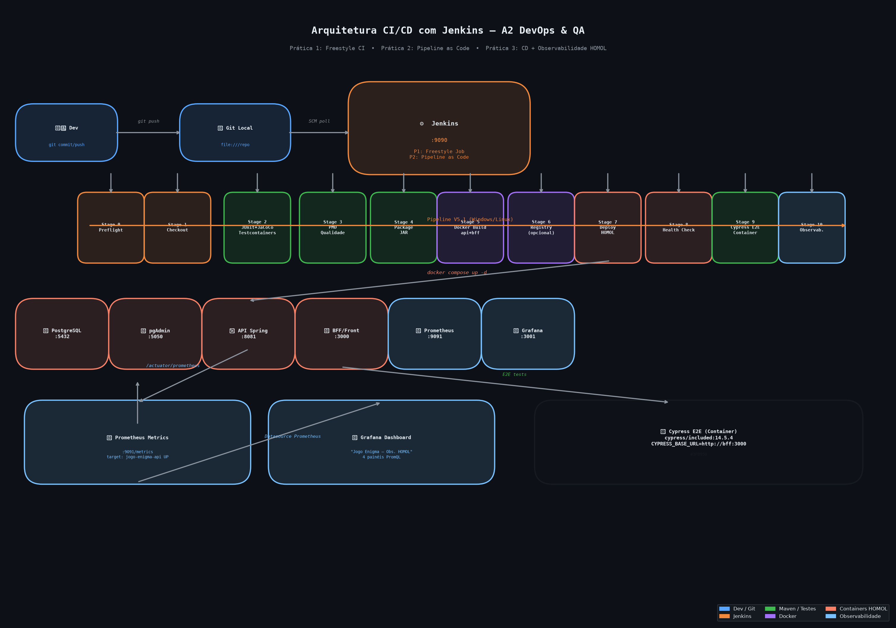
*Figura 1: Arquitetura completa da esteira CI/CD e monitoramento em homologação.*

---

## PRÁTICA 1 – JENKINS FREESTYLE – INTEGRAÇÃO CONTÍNUA

### 1.1 Configuração do Job Freestyle
- **Job:** `A2_P1_integracao_ci`
- **Projeto:** `integracao_v1`
- **Configurações:** Git SCM local, build Maven com meta `clean verify`, publicadores de teste JUnit (`**/target/surefire-reports/*.xml`) e JaCoCo (`target/site/jacoco`).

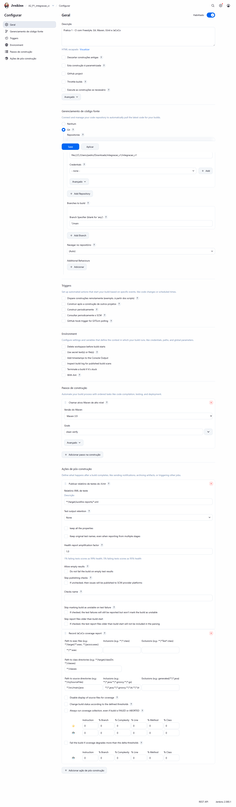
*Figura 2: Tela de configuração do Job Freestyle com os passos de compilação e pós-build.*

### 1.2 Experimento: Falha Controlada (Build Vermelho)
- **Ação:** Alteração proposital na classe `Aluno.java`, invertendo a validação de presença (`frequencia >= 75` alterado para `frequencia < 75`).
- **Comportamento:** Ao disparar o build, o Maven Surefire reprovou os testes unitários da classe `AlunoTest`, interrompendo o build com status vermelho (falha).

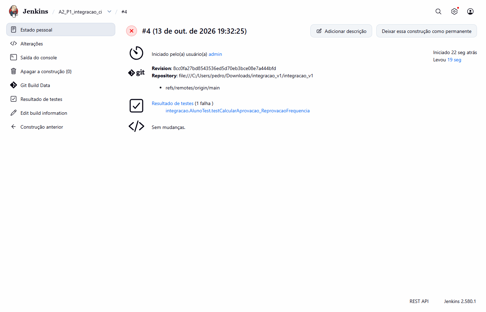
*Figura 3: Histórico de builds indicando que o Build #4 falhou após o commit com defeito.*

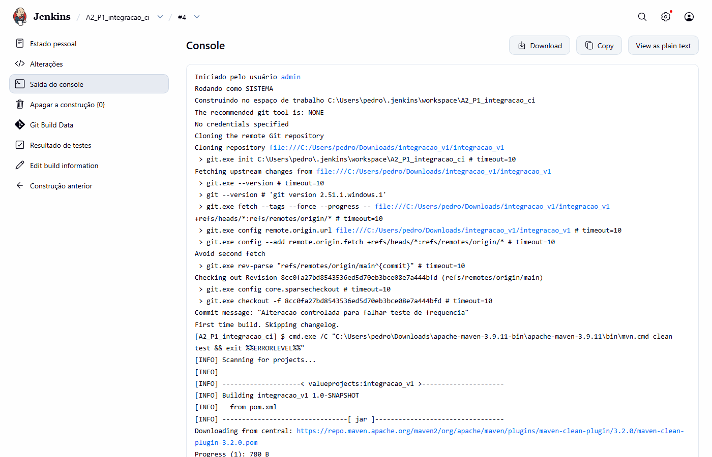
*Figura 4: Trecho do Console Output registrando a falha nos testes e o BUILD FAILURE do Maven.*

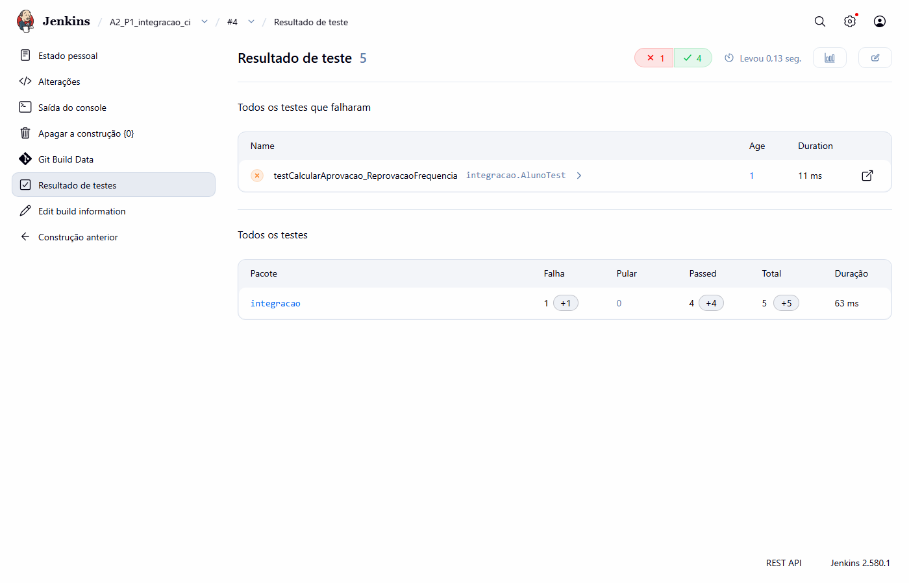
*Figura 5: Painel do JUnit no Jenkins destacando o teste reprovado com a causa da asserção.*

### 1.3 Experimento: Correção e Sucesso (Build Verde)
- **Ação:** Correção da regra de negócio em `Aluno.java` para `frequencia >= 75` e novo commit no repositório.
- **Comportamento:** O build subsequente executou com êxito total, aprovando todos os testes e publicando as métricas de cobertura.

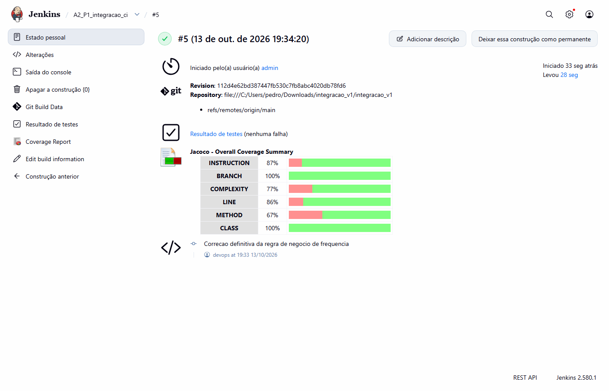
*Figura 6: Histórico de builds apresentando status estável (azul/verde) no Build #5.*

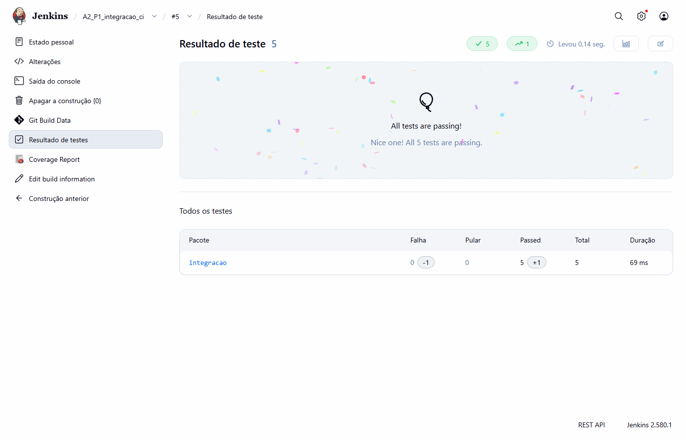
*Figura 7: Relatório JUnit no Jenkins com 0 falhas e tempo de execução dos testes.*

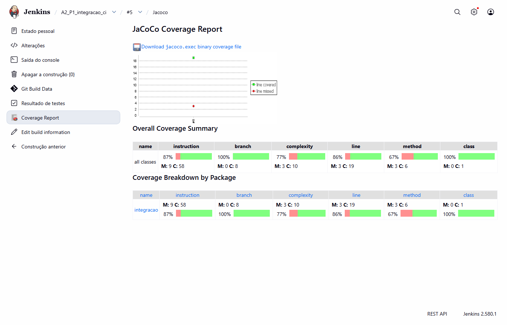
*Figura 8: Relatório JaCoCo publicado pelo Jenkins detalhando cobertura de linhas, branches e pacotes.*

### 1.4 Análise da Prática 1

- **Em qual etapa desta prática ocorre CI?**  
  A Integração Contínua se manifesta na automação das validações de qualidade: uma vez iniciado o build no Jenkins (que nesta prática laboratorial foi disparado manualmente sob demanda após o commit local, pois os gatilhos automáticos de polling/webhook não estavam ativos na configuração do job), o servidor executa de forma 100% automatizada o checkout do SCM, a compilação do código, a execução dos testes unitários com JUnit e o cálculo da cobertura com JaCoCo, fornecendo feedback imediato de aprovação ou rejeição da alteração.

- **Por que o Jenkins não substitui Maven, JUnit ou JaCoCo?**  
  Porque o Jenkins é exclusivamente um **orquestrador**: ele coordena os momentos de disparo e publica os resultados. O trabalho efetivo de compilar e gerenciar dependências é do Maven; a validação das regras de negócio é do JUnit; e a mensuração da cobertura é do JaCoCo. O Jenkins depende dessas ferramentas para executar cada etapa.

- **O que o build vermelho informa à equipe antes de qualquer deploy?**  
  Informa que o código comitado quebrou regras de negócio ou contratos técnicos pré-estabelecidos. Ele atua como um portão de qualidade (*quality gate*), impedindo que um artefato defeituoso avance para ambientes integrados ou homologação.

- **Qual a vantagem de publicar JUnit e JaCoCo no próprio Job?**  
  Centraliza a visibilidade de qualidade em um único painel acessível a todo o time, exibe tendências históricas de estabilidade e cobertura ao longo do tempo e dispensa a necessidade de inspecionar manualmente arquivos locais de relatório.

---

## PRÁTICA 2 – PIPELINE AS CODE COM JENKINSFILE

### 2.1 Configuração do Pipeline
- **Job:** `A2_P2_jogo_enigma_pipeline` (tipo *Pipeline*)
- **Configuração:** *Pipeline script from SCM*, repositório Git local do projeto `jogo-enigma` e Script Path definido como `Jenkinsfile`.

### 2.2 Execução do Pipeline e Stage View
O pipeline foi executado e estabilizado com êxito. Conforme demonstrado no histórico do Stage View, após uma execução inicial de ajuste (Build #1), a execução final consolidada (**Build #2**) obteve sucesso verde em todos os seus estágios ativos, com o estágio 6 (*Registry - Docker Hub*) sendo ignorado de forma planejada via parâmetro de controle (`when { expression { return params.PUSH_DOCKER_HUB } }`):

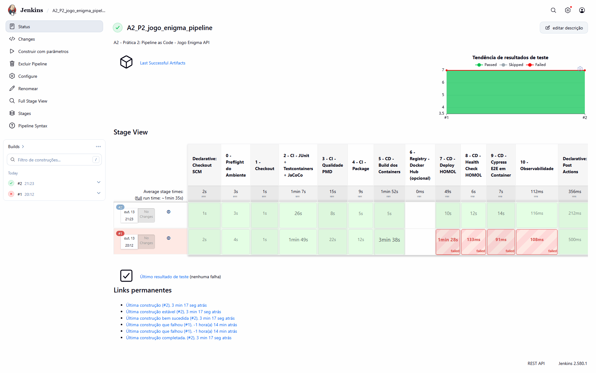
*Figura 9: Stage View do Jenkins exibindo a execução final consolidada (Build #2) com aprovação em todos os estágios ativos do Jenkinsfile e o estágio de Docker Hub ignorado via parâmetro.*

### 2.3 Leitura Arquitetural dos Stages

| Stage | Classificação | Responsabilidade |
| :--- | :--- | :--- |
| **0 - Preflight do Ambiente** | Base / Diagnóstico | Valida runtimes locais (Java, Docker CLI, Compose, Engine) em *fail-fast* |
| **1 - Checkout** | Base | Baixa a versão rastreável e auditada do repositório Git |
| **2 - CI - JUnit + Testcontainers + JaCoCo** | CI | Executa testes com banco PostgreSQL 17 real via Testcontainers e gera cobertura |
| **3 - CI - Qualidade PMD** | CI | Realiza inspeção estática de código-fonte (`pmd.html`) |
| **4 - CI - Package** | CI | Empacota a aplicação Java gerando o artefato `.jar` |
| **5 - CD - Build dos Containers** | CI → CD (Transição) | Cria as imagens Docker da API e do BFF |
| **6 - Registry - Docker Hub** | CD (Opcional) | Publicação remota da imagem (ignorado via parâmetro na execução local) |
| **7 - CD - Deploy HOMOL** | CD | Orquestra a subida dos containers com `docker compose up -d` |
| **8 - CD - Health Check HOMOL** | CD | Valida a disponibilidade da API (`/actuator/health`) via rede interna |
| **9 - CD - Cypress E2E em Container** | CD | Executa testes ponta a ponta na interface gráfica via container Cypress |
| **10 - Observabilidade** | Operação | Notifica as URLs e portas dos serviços para monitoramento |

### 2.4 Análise da Prática 2

- **Qual a principal diferença entre configurar a esteira no Freestyle e defini-la em Jenkinsfile?**  
  No Freestyle, a esteira é montada através de formulários manuais na interface web do Jenkins, ficando isolada no servidor. No Jenkinsfile (*Pipeline as Code*), a esteira é um script em código versionado no próprio repositório Git junto à aplicação, permitindo rastreabilidade, auditoria e reprodução idêntica em qualquer infraestrutura.

- **Por que versionar o pipeline junto ao código?**  
  Para garantir que a esteira evolua em sincronia com o software. Qualquer mudança arquitetural (nova dependência, novo teste ou mudança de porta) é tratada em conjunto no mesmo Pull Request, mantendo histórico de autoria e permitindo *rollbacks* consistentes.

- **Se o estágio de testes falhar, os estágios de container/deploy devem continuar? Justifique.**  
  **Não.** O pipeline deve interromper a execução imediatamente (*fail-fast*). Subir containers ou implantar código reprovado desperdiça recursos computacionais e introduz versões sabidamente defeituosas no ambiente compartilhado de homologação.

- **Qual estágio representa a transição mais clara entre CI e CD?**  
  O estágio **Build dos Containers (Stage 5)**. Nele, o código compilado e validado nos testes unitários e estáticos deixa de ser apenas um artefato de compilação (`.jar`) e passa a ser empacotado como uma unidade padronizada e implantável (imagem Docker).

---

## PRÁTICA 3 – CD, CONTAINERS E OBSERVABILIDADE

### 3.1 Validação dos Ambientes em HOMOL
Com o pipeline finalizado, os containers da stack foram validados via `docker ps` e acesso direto às URLs de cada serviço.

#### Containers em Execução (`docker ps`)

A listagem completa dos containers em execução confirma toda a stack HOMOL ativa, com portas mapeadas conforme a topologia definida:

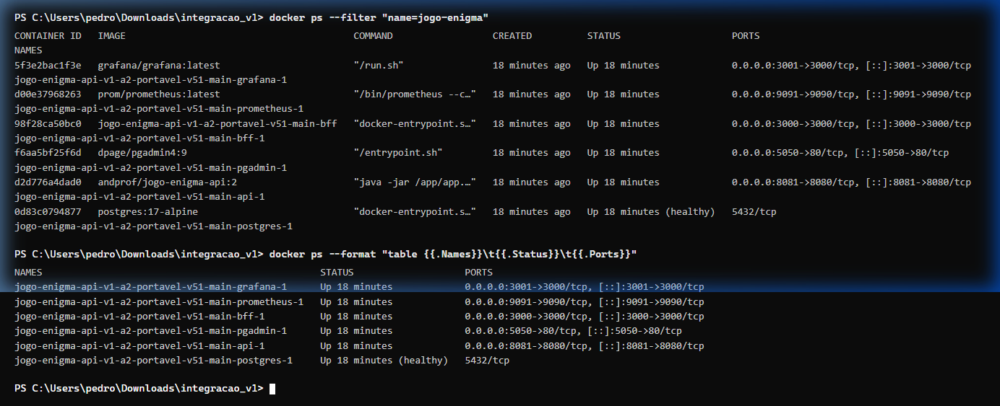
*Figura 10: Saída do `docker ps` exibindo os 6 containers da stack (API, BFF, PostgreSQL, pgAdmin, Prometheus e Grafana) com estado Up e portas mapeadas.*

> **Serviços e Portas confirmados:**  
> - `api` → `0.0.0.0:8081→8080/tcp`  
> - `bff` → `0.0.0.0:3000→3000/tcp`  
> - `postgres` → `5432/tcp` (healthy)  
> - `pgadmin` → `0.0.0.0:5050→80/tcp`  
> - `prometheus` → `0.0.0.0:9091→9090/tcp`  
> - `grafana` → `0.0.0.0:3001→3000/tcp`

#### API Spring Boot – Health Check

O endpoint `/actuator/health` da API confirmou status `UP` com os grupos `liveness` e `readiness` operacionais:

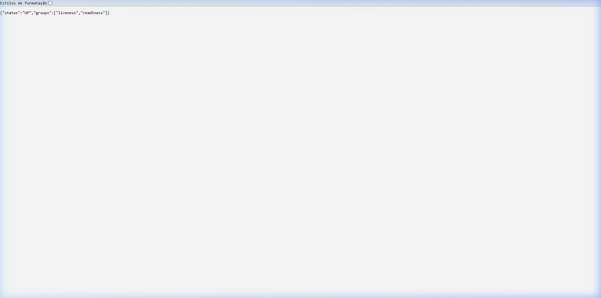
*Figura 11: Navegador exibindo `http://localhost:8081/actuator/health` com resposta `{"status":"UP","groups":["liveness","readiness"]}`.*

#### BFF / Frontend

A interface web do BFF respondeu corretamente em `http://localhost:3000`, confirmando a integração Front → BFF Node.js → API Spring Boot → PostgreSQL:

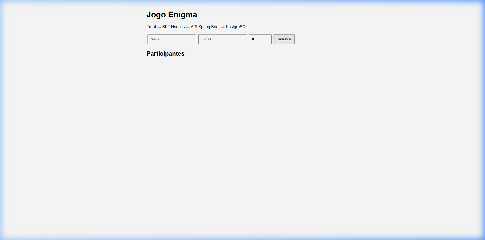
*Figura 12: Navegador exibindo `http://localhost:3000` com o formulário de cadastro de participantes do Jogo Enigma operacional.*

#### Prometheus – Target em UP

O Prometheus confirmou o scrape ativo do endpoint `/actuator/prometheus` da API:

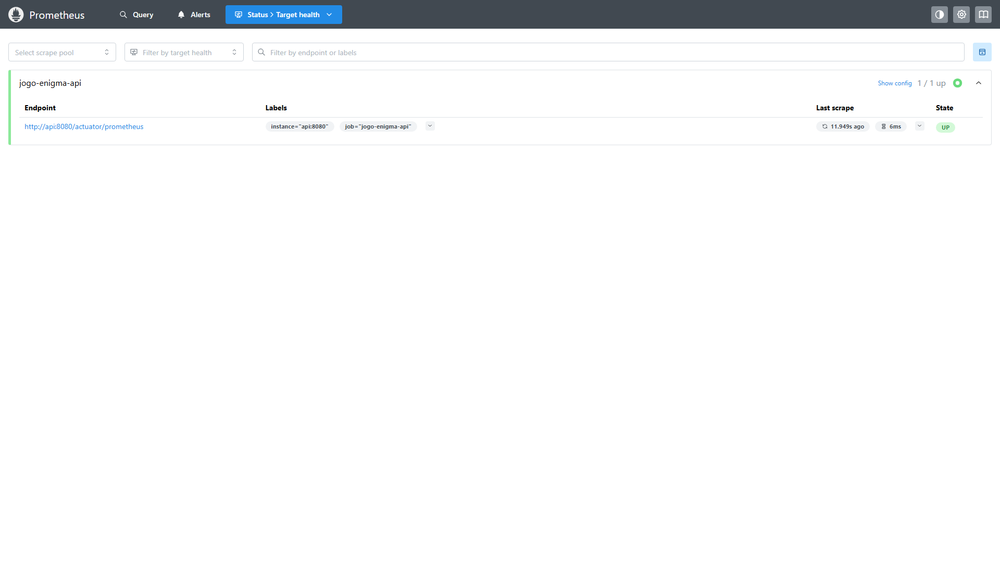
*Figura 13: Interface do Prometheus demonstrando o target `jogo-enigma-api` no estado `UP` e raspando o endpoint de métricas.*

### 3.2 Execução do Cypress E2E
O Cypress foi executado pelo pipeline via container oficial (`cypress/included:14.5.4`), consumindo diretamente o BFF (`http://bff:3000`) dentro da rede Docker. Os 3 testes de ponta a ponta foram aprovados: abertura da home via BFF, cadastro de participante e rejeição de e-mail duplicado via API/BFF.

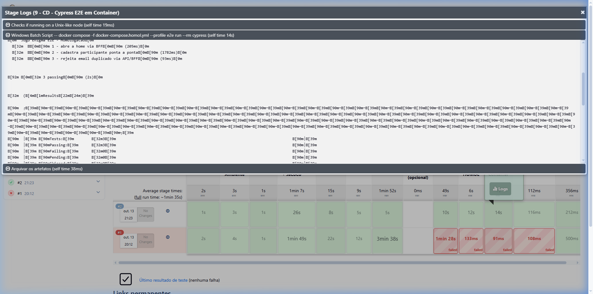
*Figura 14: Stage Logs do Stage 9 (CD – Cypress E2E em Container) do build #2 do pipeline `A2_P2_jogo_enigma_pipeline`, exibindo 3 testes passando e o Stage View com todos os estágios verdes.*

### 3.3 Observabilidade – Grafana Explore com `up{job="jogo-enigma-api"} = 1`

A consulta PromQL `up{job="jogo-enigma-api"}` executada no **Grafana Explore** retornou o valor `1`, confirmando que o Prometheus está coletando métricas da API e que o target está ativo:

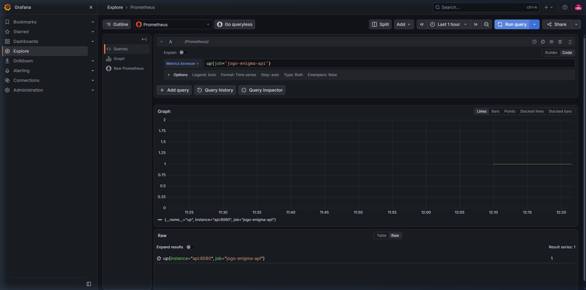
*Figura 15: Grafana Explore com a query PromQL `up{job="jogo-enigma-api"}` retornando valor `1` (série `{instance="api:8080", job="jogo-enigma-api"}`), confirmando a integração Prometheus → Grafana operacional.*

### 3.4 Análise da Prática 3

- **Por que um BUILD SUCCESS não garante que a aplicação implantada esteja operacional?**  
  Porque o build valida apenas a compilação e a lógica isolada em nível de código. Ele não testa fatores de infraestrutura, como falhas de resolução de DNS entre containers, variáveis de ambiente incorretas, indisponibilidade do banco de dados relacional ou conflitos de porta no host.

- **Qual é a função do Health Check no CD?**  
  Atua como uma sonda de prontidão (*readiness probe*): assegura que a aplicação e suas conexões essenciais (como banco de dados) estão inicializadas e saudáveis antes de liberar o tráfego de usuários ou iniciar os testes automatizados E2E.

- **Qual é o papel do Docker Compose no ambiente de homologação?**  
  Permite definir, subir e interconectar toda a topologia de múltiplos microserviços (banco, backend, frontend e observabilidade) de forma declarativa e isolada em uma mesma rede virtual com um único comando.

- **Qual é a relação entre Prometheus e Grafana? Explique por que o Prometheus coleta/armazena métricas e o Grafana consulta essas métricas para visualização.**  
  O **Prometheus** é o coletor e banco de séries temporais: ele realiza requisições periódicas (*pull/scrape*) no endpoint `/actuator/prometheus` da API e armazena os dados históricos carimbados no tempo. Já o **Grafana** é a camada de apresentação: ele não coleta métricas diretamente da aplicação, mas consome o Prometheus como *Data Source*, executando consultas na linguagem PromQL para gerar gráficos e dashboards em tempo real.

---

## 4. FECHAMENTO – DASHBOARD GRAFANA

### 4.1 Dashboard "Jogo Enigma – Observabilidade HOMOL"
Conforme solicitado no tutorial, foi construído o dashboard completo integrando 4 painéis de monitoramento:
1. **Status da API:** Painel do tipo *Stat* com query PromQL `up{job="jogo-enigma-api"}` (exibe `UP` em verde).
2. **Requisições HTTP/s:** Gráfico temporal com taxa de requisições por segundo: `rate(http_server_requests_seconds_count{job="jogo-enigma-api"}[1m])`.
3. **Tempo Médio de Resposta:** Latência média em segundos: `rate(http_server_requests_seconds_sum[1m]) / rate(http_server_requests_seconds_count[1m])`.
4. **Memória JVM – Heap:** Consumo da memória Heap em bytes: `jvm_memory_used_bytes{job="jogo-enigma-api", area="heap"}`.

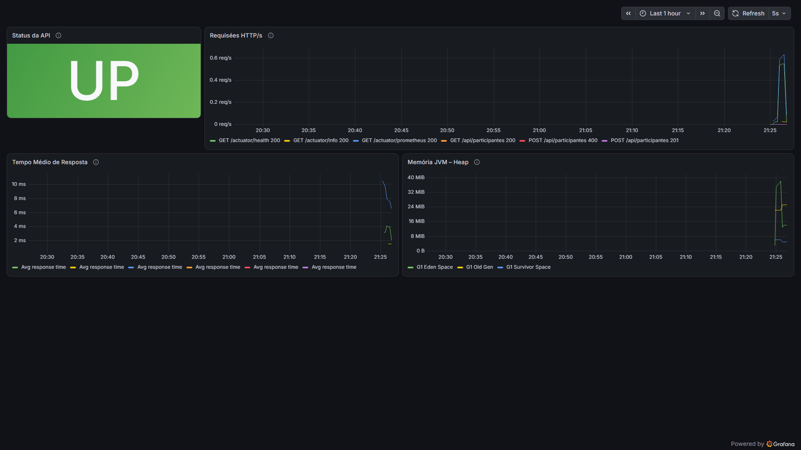
*Figura 16: Dashboard de observabilidade em homologação no Grafana com os 4 painéis operacionais e métricas ativas.*

*(O arquivo de especificação do painel foi exportado em `evidencias/grafana/dashboard.json`)*

---

## 5. QUESTÕES PARA FECHAMENTO DO EXERCÍCIO

1. **Em que ponto da A2 termina a Integração Contínua e começa a Entrega/Implantação Contínua?**  
   *Resposta:* A Integração Contínua se encerra no estágio de empacotamento do artefato (**Stage 4 - Package**), após testes unitários, análise estática e geração do `.jar`. A Entrega/Implantação Contínua se inicia na geração da imagem de container (**Stage 5 - Docker Build**) e se estende pelo provisionamento do ambiente (**Deploy HOMOL**), testes de fumaça (**Health Check**) e validação E2E (**Cypress**).

2. **Qual vantagem arquitetural o Jenkinsfile oferece em relação à configuração exclusivamente Freestyle?**  
   *Resposta:* O Jenkinsfile confere rastreabilidade e governança ao processo de entrega. Por residir no Git, qualquer alteração na infraestrutura da esteira passa por revisão por pares (*code review*), possui histórico de commits e permite recriar ou versionar esteiras inteiras instantaneamente em ambientes híbridos ou novos servidores.

3. **Por que JUnit deve ser executado antes da criação/deploy do container e Cypress depois do deploy?**  
   *Resposta:* O **JUnit** testa unidades e contratos de código de forma rápida e isolada, devendo reprovar o build o quanto antes (*fail-fast*) para evitar custo desnecessário de containerização. Já o **Cypress** testa a integração de ponta a ponta na perspectiva do usuário final no navegador, exigindo obrigatoriamente que a API, o BFF e o banco de dados estejam em execução e interconectados.

4. **Como observabilidade se relaciona com a qualidade de uma aplicação após sua implantação?**  
   *Resposta:* Os testes automatizados em CI/CD atestam a qualidade *estática e funcional prévia*, enquanto a observabilidade (Prometheus/Grafana) atesta a qualidade e estabilidade *dinâmica e contínua em produção/homologação*. Ela permite detectar vazamentos de memória (JVM), degradação progressiva de latência e picos anômalos de erro HTTP antes que afetem criticamente os usuários.

5. **Qual conhecimento do Exercício A1 foi reutilizado diretamente na construção desta esteira?**  
   *Resposta:* Foram reaproveitados os conhecimentos de testes unitários com **JUnit 5**, cobertura de código com **JaCoCo** e análise estática de conformidade e boas práticas com **PMD**. Na A1 essas ferramentas foram executadas de forma manual/local no Maven; na A2 elas foram elevadas a etapas automatizadas e obrigatórias da esteira de CI/CD.

6. **Conclusão: O que mudou arquiteturalmente do Exercício A1 para o Exercício A2?**  
   *Resposta:* Arquiteturalmente, o foco migrou de práticas isoladas de garantia de qualidade executadas na máquina do desenvolvedor (A1) para um **ecossistema integrado, orquestrado e automatizado de entrega contínua (A2)**. A esteira passou a ser regida por código versionado (*Pipeline as Code*), o código foi containerizado para garantir imutabilidade de ambiente (Docker/Compose), os testes foram expandidos para nível de sistema (Cypress E2E) e foi incorporada a telemetria em tempo real (Prometheus/Grafana), conectando desenvolvimento, qualidade e operações em um ciclo DevOps completo.
